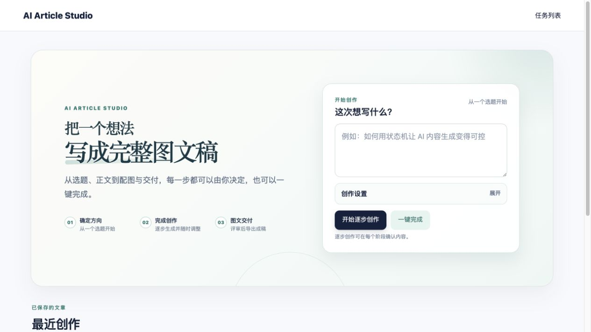

# AI Article Studio

> 从一个选题，到可交付的图文稿。
> From one topic to a reviewed, export-ready illustrated article.



## 中文

AI Article Studio 是一个单用户本地创作工作台：你可以逐步确认标题、大纲、正文与配图，也可以一键完成整篇图文稿。它将可编辑的创作流程、图像供应链、质量评审和交付导出组合在一个 Python 应用中。

### 核心能力

- **逐步创作与一键完成**：后台任务会展示真实阶段、失败原因和可重试入口。
- **流式正文生成**：通过 SSE 实时呈现正文，并保留 Markdown 编辑与预览。
- **智能配图**：支持 Mock、Pexels、SiliconFlow、Google AI 与按视觉角色自动分流；可调整位置、单图重试并记录来源。
- **质量与交付**：内容质量闸门、最多一次自动修订，以及 Markdown、HTML、ZIP 三种导出。
- **本地优先与安全边界**：密钥仅从本地环境变量读取；下载与导出仅接受受信任来源；默认不包含登录或多用户能力。

### 技术栈

Python 3.13 · uv · FastAPI · SQLAlchemy · SQLite / PostgreSQL · Pydantic · Jinja2 · HTMX · SSE · httpx · pytest · Ruff

### 快速启动

```bash
uv sync
uv run uvicorn ai_article_studio.main:app --reload --port 8124
```

打开 <http://127.0.0.1:8124/article/list>。未创建 `.env` 时，应用默认以 Mock 模式运行，可完整体验工作流而不会调用外部模型。

### 接入真实模型

复制 `.env.example` 为 `.env`，填入 OpenAI-compatible 文本模型及需要的图片供应商密钥。百炼（DashScope）可作为 OpenAI-compatible 端点使用；Pexels、SiliconFlow 和 Google AI 均可按需启用。密钥不会被写入数据库、日志、接口响应或 Git。

```bash
cp .env.example .env
```

### 验证

```bash
uv run pytest
uv run ruff check .
node --check src/ai_article_studio/static/stream.js
```

---

## English

AI Article Studio is a single-user local workspace for producing illustrated articles. Review a topic, title, outline, article, and visuals step by step—or let the workflow complete the entire draft in one run.

### Highlights

- Guided and one-click workflows with background jobs, truthful progress, retry points, and recovery after interruption.
- SSE article streaming with Markdown editing and preview.
- Visual planning, source-aware image generation or search, editable placement, and per-image retry.
- Content quality gates, one automatic revision round, and Markdown, HTML, or ZIP delivery.
- Local-first credential handling: API keys stay in environment variables and are never committed, logged, or returned by the application.

### Run locally

```bash
uv sync
uv run uvicorn ai_article_studio.main:app --reload --port 8124
```

Visit <http://127.0.0.1:8124/article/list>. Without a local `.env`, the app runs in deterministic Mock mode and does not contact external AI providers.

## Project boundary

This is a local, single-user demonstration application. It intentionally does not include authentication, multi-tenant data isolation, or hosted secret management.
